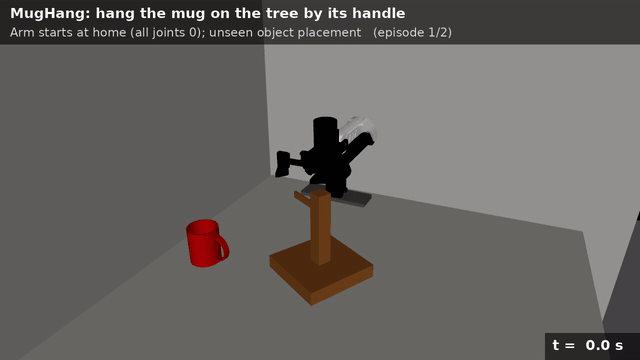

# SuperMimic 机械臂操作（中文入口）

本仓库把 [SuperMimic](https://arxiv.org/abs/2610.28480)（通过可微的学习世界模型反传任务回报来优化策略）
从人形机器人动作跟踪迁移到基于状态的机械臂操作任务，回合的初始状态采用
[OmniReset](https://arxiv.org/abs/2603.15789) 式的 reset 分布。仿真基于
[mjlab](https://github.com/mujocolab/mjlab)（MuJoCo Warp），机器人为仿真 ARX5 机械臂。

详细文档以英文为准（[README.md](README.md) 与 [docs/](docs/)），本页给出概览。

<table>
  <tr>
    <th>Lemon：把柠檬放到盘子上</th>
    <th>BoxInBin：把箱子放进容器</th>
    <th>MugHang：把杯子按杯把挂上杯架</th>
  </tr>
  <tr>
    <td></td>
    <td></td>
    <td></td>
  </tr>
</table>

每段视频是训练好的策略的两个回合：机械臂从各关节为 0 的初始位姿出发，物体和目标的摆放来自
独立的测试 reset bank。策略只使用低维状态，画面仅用于观看。

## 结果

以下都是原生任务成功率（仿真中的原始成功判据并保持 0.5 s），确定性策略、完整回合，没有筛选回合。

**独立测试 reset bank**：每个任务 256 个回合，每个 reset 类别 64 个；测试 bank 与训练 bank
使用不同的随机种子和划分采集。所有任务都使用第 4,000 轮的 checkpoint。

| 任务 | 训练轮数 | 训练时长 | 总成功率 | 各类别 0 / 1 / 2 / 3 |
| --- | --- | --- | --- | --- |
| `lemon` | 4,000 | 1.8 h | **100.0%** | 100 / 100 / 100 / 100 |
| `box_in_bin` | 4,000 | 1.9 h | **94.9%** | 97 / 91 / 95 / 97 |
| `mug_hang` | 4,000 | 2.8 h | **96.9%** | 94 / 98 / 95 / 100 |

训练时长是从启动到该 checkpoint 的实际耗时，包括前 1,000 轮只训练世界模型的阶段，均为单卡
（见[硬件配置](#硬件配置)）。训练时与其他任务共用一张卡，所以这些时间是上限。MugHang 在第
1,000 轮被中断后从该 checkpoint 继续，时长包含两段。

类别 0 是完整任务（物体在桌上、夹爪空闲），类别 1–3 从任务中途开始（物体已被抓住）。

**数据量**：4,000 轮共采集 4,100 万条仿真转移（4,096 个并行环境，按 20 Hz 约合 24 天的仿真
时间）。策略只通过世界模型训练，没有使用任何策略梯度（PPO）更新。

## 硬件配置

每个训练 run 使用同一台服务器上的一张 GPU：

| 部件 | 配置 |
| --- | --- |
| GPU | 每个 run 1 张 NVIDIA A100-SXM4-80GB（驱动 535.230，CUDA 12.2），每个 run 约占 27 GB 显存 |
| CPU | Intel Xeon Platinum 8336C（112 线程），服务器上所有任务共用 |
| 软件 | PyTorch 2.9.1（CUDA 12.8 版本）、mjlab 1.5.3、MuJoCo 3.10、MuJoCo Warp、Warp 1.17 |
| 仿真 | 4,096 个并行环境，普通 CUDA Graph（`--cuda-graph-mode plain`，驱动低于 CUDA 12.4 时需要） |
| 精度 | MLP 使用 BF16 autocast，参数为 FP32，矩阵乘启用 TF32 |

每轮迭代（采集、世界模型更新、一次 actor/critic 更新）约 1.4–2.8 秒，取决于任务和是否共卡。

## 思路

SuperMimic 原本用于人形机器人动作跟踪，每一步都有稠密的跟踪奖励。机械臂操作不同：决定性的
奖励是一个稀疏的成功判据，而且依赖接触（物体被支撑、已松手、静止）；任务长度也远超策略在
模型里能向前看的 16 步。我们的迁移分四部分：

1. **用初始状态缩短任务（OmniReset）。** 参照 OmniReset，每个任务有一个经过物理验证的
   reset bank，分四类初始状态：完整任务（物体在桌上、夹爪空闲）、物体在桌上已抓住、
   物体在空中已抓住、物体在目标附近已抓住。训练时均匀采样各类。靠后的类别让成功判据落在
   16 步想象 rollout 的范围内，在那里学到的价值再一步步传回完整任务。初始状态由程序生成
   （抓取状态用逆运动学求解），只保留在任务自身物理和控制器下能保持有效的状态。

2. **世界模型只预测物理状态。** 机械臂由操作空间控制器（OSC）驱动，每个动作都以当前末端
   位姿为基准，控制器没有内部记忆。世界模型根据实际执行的控制指令，预测关节以及物体位姿和
   速度的增量（共 28 维），并以该回合随机化的物理参数为条件（各维度的含义见
   [docs/supermimic.md](docs/supermimic.md#world-model)）。想象中的策略观测由预测状态经
   可微正运动学重建，在真实状态上与仿真器的观测误差约 1e-6。

3. **解析奖励和可微的成功判据。** 奖励不靠学习，而是用任务本身的权重从想象状态直接算出。
   依赖接触的成功判据换成几何代理（例如用"两指张开超过阈值"代替"手指不接触物体"）：
   前向是硬判定，反向用 sigmoid 直通梯度。这样 critic 看到的是真实的 +10 成功奖励，actor
   得到可用的梯度，并乘以 0.02 防止它主导优化。0.5 s 的保持计时作为解析计数器传递。

4. **只在想象中加的引导项，补上原生奖励没有梯度的地方。** 物体放好后，接近奖励停止，
   改为奖励张开手指，因此"一直抓着"永远不会比"松手"更划算。MugHang 的原生挂杯奖励在杯把
   没对准横杆时为零，所以想象中额外加了一个把杯把拉向挂点的长程引导。这些项只存在于想象中；
   数据采集、报告的奖励和所有评估都使用未修改的原生任务。

每轮迭代：用当前策略加高斯噪声采集真实转移；用 8 步开环窗口拟合世界模型；从回放状态出发
想象 16 步，通过时间反向传播最大化想象回报加 TD(λ) critic 的价值；再拟合 critic。前 1,000
轮只训练世界模型。详见 [docs/supermimic.md](docs/supermimic.md)。

## 安装

需要 Linux、NVIDIA GPU、[uv](https://docs.astral.sh/uv/) 和 Git LFS。

```bash
git lfs pull
uv sync --locked --extra dev
source .venv/bin/activate        # 或在每条 clab 命令前加 `uv run`
```

下面命令中的 `--cuda-graph-mode plain` 在驱动低于 CUDA 12.4 时需要，新驱动可以去掉。
所有命令都不会覆盖已有输出。

## 训练好的模型与 reset bank

| Hugging Face 仓库 | 内容 |
| --- | --- |
| [emopointer/supermimic-manipulation](https://huggingface.co/emopointer/supermimic-manipulation) | 结果表中的三个 checkpoint：`<task>/model_004000.pt`（世界模型、actor、critic 与优化器状态），训练设置在 `<task>/params/` |
| [emopointer/supermimic-manipulation-reset-banks](https://huggingface.co/datasets/emopointer/supermimic-manipulation-reset-banks) | 训练用 bank `<task>_train.pt`（每类 10,000 个状态）和独立测试 bank `<task>_test.pt`（每类 256 个） |

`<task>` 为 `lemon`、`box_in_bin` 或 `mug_hang`。用 Hugging Face 命令行下载（通过 `uvx` 运行，
不会往环境里加依赖）：

```bash
uvx --from huggingface_hub hf download emopointer/supermimic-manipulation \
  --local-dir checkpoints
uvx --from huggingface_hub hf download emopointer/supermimic-manipulation-reset-banks \
  --repo-type dataset --local-dir banks
```

## 流程 A：直接使用训练好的 checkpoint

按上面下载两个仓库，然后在独立测试 bank 上评估，即可复现结果表（256 个完整回合，每个
reset 类别 64 个）：

```bash
TASK=box_in_bin        # lemon | box_in_bin | mug_hang
clab eval policy --task $TASK --algorithm supermimic \
  --checkpoint checkpoints/$TASK/model_004000.pt \
  --reset-bank banks/${TASK}_test.pt --episodes-per-type 64 --num-envs 64 \
  --seeds 100000 --split-label held_out --cuda-graph-mode plain \
  --output reports/${TASK}_heldout.json
```

报告中有总成功率、各类别成功率、回合长度和回报。`checkpoints/$TASK/params/` 要和
checkpoint 放在一起，评估时会用它检查训练环境与当前环境是否一致。

如果想在训练好的模型上继续训练，用 `--resume`。`--iterations` 表示再训练的轮数，再训
6,000 轮即达到默认的总共 10,000 轮。世界模型、actor、critic、优化器和迭代计数都会恢复；
回放缓存没有保存，会先重新采集。

```bash
clab train supermimic --task $TASK --reset-bank banks/${TASK}_train.pt \
  --resume checkpoints/$TASK/model_004000.pt --iterations 6000 \
  --output logs/supermimic/${TASK}_resumed --cuda-graph-mode plain
```

## 流程 B：从零开始训练

1. **采集 reset bank**：训练 bank 和用不同随机种子、不同划分采集的独立测试 bank
   （也可以直接下载上面发布的 bank，跳过这一步）。

   ```bash
   TASK=box_in_bin        # lemon | box_in_bin | mug_hang
   clab resets collect --task $TASK --output banks/${TASK}_train.pt --split train
   clab resets collect --task $TASK --output banks/${TASK}_test.pt \
     --split test --seed 7 --per-type 256
   ```

2. **训练**：默认 10,000 轮，每 1,000 轮保存一次 checkpoint，结果表用的是
   `model_004000.pt`；前 1,000 轮只训练世界模型。

   ```bash
   clab train supermimic --task $TASK --reset-bank banks/${TASK}_train.pt \
     --output logs/supermimic/$TASK --seed 1 --cuda-graph-mode plain
   ```

   训练过程记录在 TensorBoard（`tensorboard --logdir logs/supermimic`），包括训练回合中
   各类别的成功率。

3. **评估**：在独立测试 bank 上评估。

   ```bash
   clab eval policy --task $TASK --algorithm supermimic \
     --checkpoint logs/supermimic/$TASK/model_004000.pt \
     --reset-bank banks/${TASK}_test.pt --episodes-per-type 64 --num-envs 64 \
     --seeds 100000 --split-label held_out --cuda-graph-mode plain \
     --output reports/${TASK}_heldout.json
   ```

## 文档导读

| 文档 | 内容 |
| --- | --- |
| [docs/supermimic.md](docs/supermimic.md) | 方法、各任务适配器（想象中的奖励与成功判据）、训练选项 |
| [docs/tasks.md](docs/tasks.md) | 三个任务的观测、奖励、成功条件和 reset 类别 |
| [docs/workflow.md](docs/workflow.md) | reset bank 采集、训练与评估流程 |

## 引用

本项目是独立的迁移实现，与两篇论文的作者无关，也不复现论文中的实验。BibTeX 见
[README.md](README.md#references)。

- **SuperMimic**：Q. Liao 等，*SuperMimic: Scaling Humanoid Whole-Body Control with One
  Differentiable World Model*，[arXiv:2610.28480](https://arxiv.org/abs/2610.28480)，2026。
  算法实现改编自开源复现 [zita-ch/supermimic_vibed](https://github.com/zita-ch/supermimic_vibed)
  （MIT 许可，原许可证保留在 `src/clab/algorithms/supermimic/REFERENCE_LICENSE`）。
- **OmniReset**：P. Yin 等，*Emergent Dexterity via Diverse Resets and Large-Scale
  Reinforcement Learning*，ICLR 2026，[arXiv:2603.15789](https://arxiv.org/abs/2603.15789)，
  [项目主页](https://weirdlabuw.github.io/omnireset/)，
  代码 [UW-Lab/UWLab](https://github.com/UW-Lab/UWLab)。本项目的 reset 类别参照其 reset 分布，
  采集器为我们自己实现。

## 许可

代码以 [MIT 许可](LICENSE) 发布。第三方代码和资产沿用各自的许可：改编自 supermimic_vibed 的代码
（MIT，见 `src/clab/algorithms/supermimic/REFERENCE_LICENSE`）、来自 robosuite 的物体模型
（MIT，见 `src/clab/tasks/lemon/assets/ROBOSUITE_LICENSE`），以及 MugHang 使用的 ShapeNet
杯子模型，须遵守 [ShapeNet 使用条款](https://shapenet.org/terms)（仅限非商业研究与教学）。
